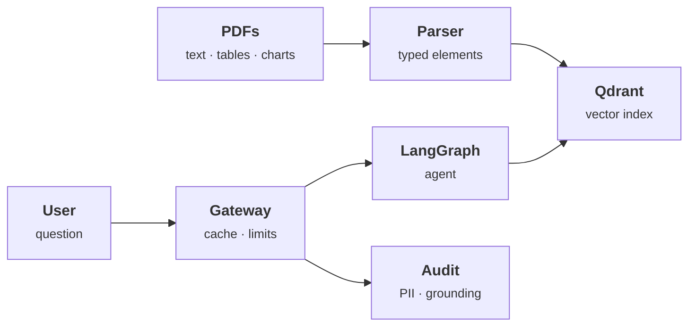

# Multimodal RAG with a governance layer

> Answers questions from text, tables and charts in PDFs, and audits every prompt and answer for leaked data and hallucination.

**Interactive demo:** [natanmartins.com.br/projects/rag-guard](https://natanmartins.com.br/projects/rag-guard/) · [versão em português](https://natanmartins.com.br/pt/projects/rag-guard/)

**Status:** in construction. This README separates what exists from what is planned, and is updated as parts ship.

## The problem

Corporate knowledge lives in PDFs full of tables and charts that plain text extraction destroys. And once an LLM can read those documents, something has to stop it from repeating a salary or inventing a number.

## Architecture



1. Documents are parsed into typed elements (paragraph, table, figure); tables keep their structure and figures get a generated description.
2. Elements are embedded and stored in Qdrant with their source page, so every answer can cite.
3. A LangGraph agent decides whether to search, read a table, or ask for clarification.
4. A gateway in front of the model caches, rate-limits, and sends every exchange to an async audit queue: PII detection, groundedness against retrieved sources, toxicity.

**Stack:** Unstructured · Qdrant · LangGraph · RabbitMQ · vLLM · FastAPI

## What exists today

### Real
- Retrieval is real: TF-IDF vectors with cosine similarity over 20 chunks, and the 3D layout is a PCA of those vectors computed in your browser.
- The ACL filter, the cache, the token-bucket rate limit, the prompt-injection rules, PII redaction and the grounding check are the actual logic.
- Millisecond timings in the trace are measured on your machine.

### Simulated in the browser demo
- The documents belong to a fictional company; names, CPFs and contacts are invented.
- There is no LLM: answers are extractive (sentences copied from the sources). The “lying LLM” switch alters a number on purpose so the grounding check has something to catch.
- TF-IDF stands in for dense embeddings, and the audit queue is a list on the page, not RabbitMQ.

### Not built yet (roadmap)
- [ ] PDF parsing of real tables and charts (Unstructured)
- [ ] Qdrant with dense embeddings and payload ACL filters
- [ ] LangGraph agent and a real LLM behind the gateway
- [ ] PII and grounding models (instead of rules) consuming from RabbitMQ

## Repository layout

```
demo/   the simulation that powers the interactive page, with tests that check its claims
```

The production pipeline will live alongside it (`pipeline/`, `docker-compose.yml`) as the roadmap items land.

## Run the demo tests

Requires Node.js 22+.

```bash
cd demo
npm test
```

## License

MIT © 2026 Natan Oliveira Martins
